<h1 align="center">Hey, I'm Rudresh 👋</h1>

  

 

I build Android apps in Kotlin and Jetpack Compose. One of them is live on the Play Store with 1,000+ installs. 
I write backends in Rust (Axum) and Python (FastAPI), and I attack my own auth before anyone else can. 
2nd-year CS student at KIET, Ghaziabad.

  <a href="https://www.rudresh.me/">rudresh.me</a> ·
  <a href="https://linkedin.com/in/rudreshrajvansh">LinkedIn</a>

 

🏆 <b><a href="https://github.com/RudreshRajvansh/Xpulse">XPulse</a></b>: patient-controlled health records (Kotlin + Rust/Axum). 1st place, BuildBreak 2026 
🏆 <b><a href="https://github.com/RudreshRajvansh/CrimeAI">CrimeAI</a></b>: links fraud FIRs across police stations. MLH Best Use of Gemini, InnoHacks 4.0

 

             

 

## Elsewhere

AWS Triple Certified · Open source: [Myne #306](https://github.com/Pool-Of-Tears/Myne/pull/306) · 14th place, CTF7

 

  <picture>
    <source media="(prefers-color-scheme: dark)"  srcset="https://raw.githubusercontent.com/RudreshRajvansh/RudreshRajvansh/output-3d-contrib/night.svg" />
    <source media="(prefers-color-scheme: light)" srcset="https://raw.githubusercontent.com/RudreshRajvansh/RudreshRajvansh/output-3d-contrib/day.svg" />
    
  </picture>

